# Laplace NS 使用指南

Laplace NS（Laplace Next Station）是一个算概率的小工具：一回合能不能打死、能不能发到想要的牌、buff 能不能挂上、敌人能不能把指定的从者送走，以及把这些串成整个多回合方案的综合成功率。所有计算都在你自己的设备上完成，不上传任何数据。

> 截图里的数字都是随手编的示例，只用来说明怎么操作。

## 开始使用

### 打开和安装

- 网址：<https://ada-yl5326.github.io/fgo-prob-calc/>
- **iPhone**：用 Safari 打开 →「分享」→「添加到主屏幕」。之后从桌面图标打开，像 App 一样全屏使用，断网也能用。
- **安卓**：浏览器菜单 →「添加到主屏幕」或「安装应用」。
- 有新版本时，页面顶部会出现「新版本已下载，点此刷新」，点一下就是最新版。

> iPhone 上从桌面图标打开和在 Safari 里打开，保存的数据可能是分开的；删掉桌面图标再重新添加，图标里保存的组会一起清空——重要的内容请先用[工作目录](#workspace)导出备份。

### 界面

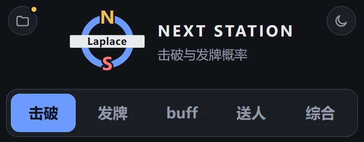

顶部：左边是工作目录，右边切换外观；下面是五个页面

- 左上角 **工作目录**：保存、切换、导出 / 导入整套设置，见[工作目录与分享](#workspace)。
- 右上角切换外观：自动（跟随系统）→ 浅色 → 深色。
- 五个页面：**击破**（一回合的击破率）、**发牌**（发到想要的牌的概率）、**buff**（buff 成功率）、**送人**（敌方行动阶段把从者送走的概率）、**综合**（把前面四种组合成整个方案）。

### 「组」：每页都可以存好几份

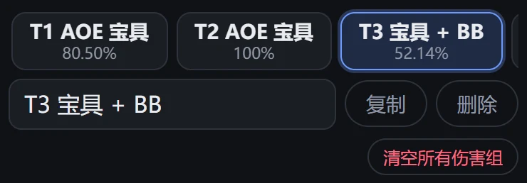

伤害组：点名字切换，＋ 新建；下面可以改名、复制、删除

前四个页面的输入都存成「组」（伤害组、发牌组、buff 组、送人组）。常见用法是每个回合一组、每种打法一组。

- 点组的名字切换；「＋ 新建」新建一个空组；「复制」复制当前组（改一点数字做对比时最方便）。
- 名字框里直接改名（最多 20 个字）；「删除」删除当前组；「清空所有X组」只留下一个空组。
- 组名下面的小字是这个组的结果，不用点进去就能看到。
- 所有输入都会自动保存在这台设备上，关掉页面再打开还在。

### 输入数字的小技巧

- 可以带千分位逗号，也可以用全角数字，输入完会自动整理成 `98,000` 这样的格式。
- 百分比直接填数字，例如成功率 65% 填 `65`。
- 填完一格按键盘上的「下一项 / 换行」会跳到下一格。
- 输入有问题时，格子下面会显示红色的说明。

## 击破概率

算一回合打出去的伤害能不能击破敌人：每一张卡（每个「伤害维度」）的伤害都会在 0.900 ~ 1.099 的随机数里单独抽一次，这一页统计全部组合，给出精确的击破率。

### 基本用法：4 张卡打一个敌人

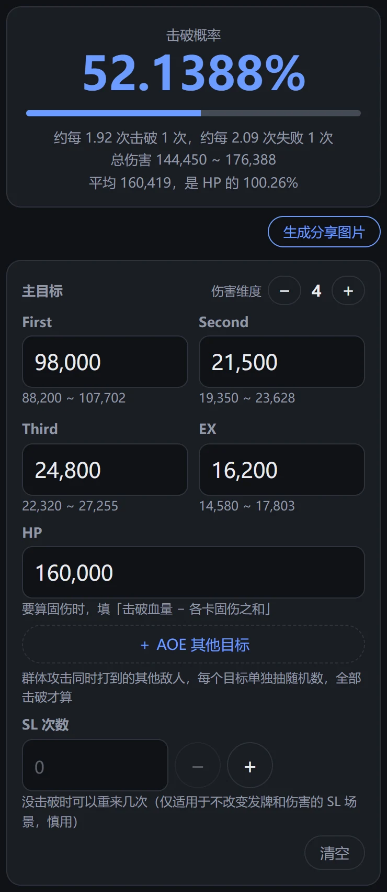

填好均伤和 HP 后，最上面就是击破率

1. 在 **First / Second / Third / EX** 填每张卡的**均伤**（伤害计算器里不含随机数的那个平均伤害）。不出的卡留空。
2. **HP** 填敌人剩下的血量。
3. 最上面立刻显示击破率，下面还有「约每几次击破一次」、总伤害的范围和平均值。

每张卡下面的小字是这张卡的伤害范围（均伤 × 0.9 ~ 均伤 × 1.099）。

> **有固伤时**：固伤不乘随机数，所以不要加进均伤里。HP 改填「击破血量 − 各卡固伤之和」即可，结果完全一样。

### 伤害维度：卡多于 4 张或少于 4 张

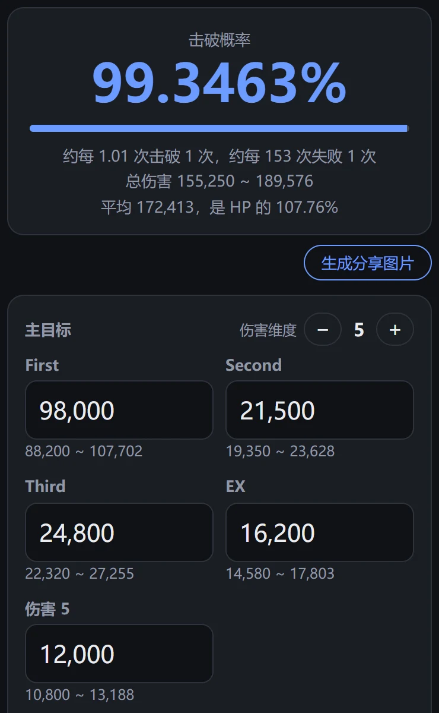

主目标的伤害维度改成 5，多出「伤害 5」一格

每个单独抽随机数的伤害算一个「维度」。主目标默认 4 维，用右上角的 **− / ＋** 改成 1 ~ 12 维：

- 只放一发宝具：改成 1 维。
- 宝具后还有追加伤害、额外攻击等单独计算随机数的伤害：加一维填进去。

6 维以内是精确值；维度多、伤害高时要算一会儿，停止输入后才开始算。

### AOE：同时打死好几个敌人

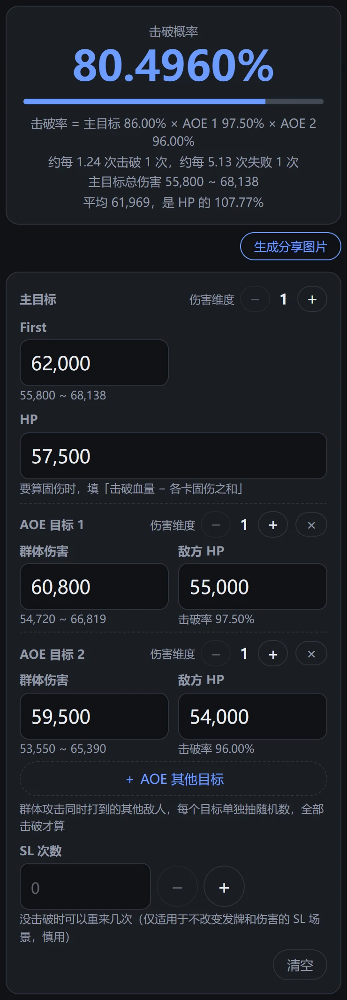

主目标 + 2 个 AOE 目标，击破率 = 三个目标的击破率相乘

群体宝具要清掉一整排时：

1. 主目标填宝具打主目标的伤害（这里把伤害维度改成 1）和它的 HP。
2. 点「＋ AOE 其他目标」，每行填宝具打到这个敌人的伤害和它的 HP，最多 5 个。
3. 每个目标单独抽随机数，**全部击破才算成功**：击破率 = 主目标 × 各 AOE 目标的击破率。每个 AOE 目标下面会显示它自己的击破率，方便找出最危险的那个。

### SL：没打死可以重来几次

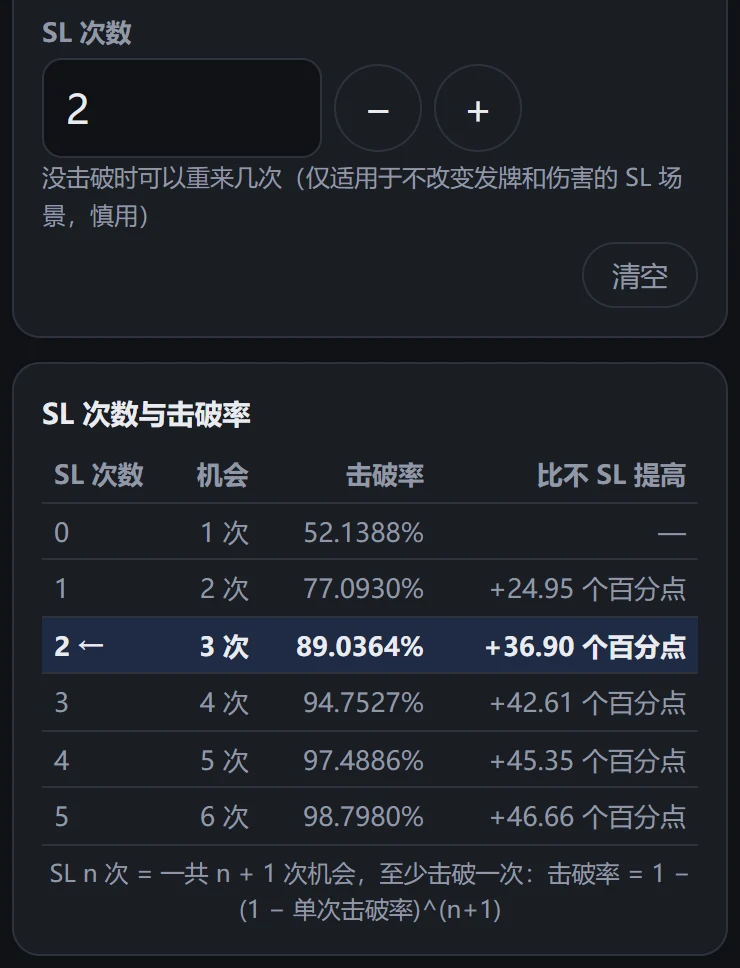

SL 2 次：一共 3 次机会，下面的表列出 SL 0 ~ 5 次的击破率

**SL 次数**填没击破时最多重来几次（也可以点 − / ＋）。SL n 次 = 一共 n + 1 次机会：击破率 = 1 − (1 − 单次击破率)^(n+1)。下面的表列出 SL 0 ~ 5 次的结果，箭头指着你填的次数。

> 只适用于 SL 后发到的牌不变、只重新抽伤害随机数的情况。要算「换一种出牌顺序再试」这类会改变出牌的 SL，请用[综合击破概率](#combo)。

### 图表：HP 再高一点还能打死吗？

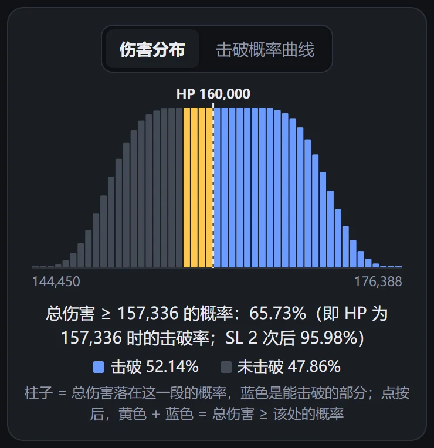

伤害分布：点按柱子，黄色 + 蓝色 = 总伤害 ≥ 那个位置的概率

**伤害分布**：每根柱子是总伤害落在这一段的概率，蓝色是能击破的部分。点按（或左右滑动）图表上任意位置，会显示「总伤害 ≥ 那里的概率」，也就是 HP 为那个数时的击破率。

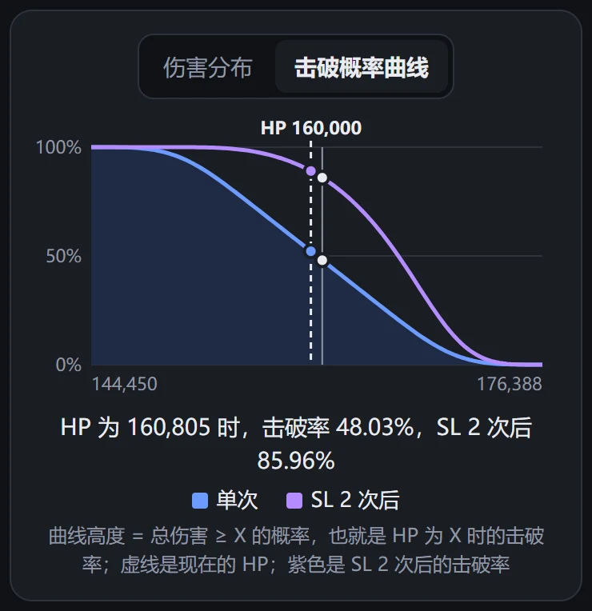

击破概率曲线：蓝色是单次，紫色是 SL 后

**击破概率曲线**：横轴是 HP，高度是这个 HP 下的击破率；填了 SL 时紫色曲线是 SL 后的击破率。点按或滑动可以查看任意 HP 的结果，适合回答「HP 多 5,000 还能打吗」。

### 从 Laplace 截图导入

在 Chaldea 的 Laplace 里算好整场战斗后，可以把它的战斗记录截图直接导入，每个回合自动生成一个伤害组，不用一格一格抄数字。

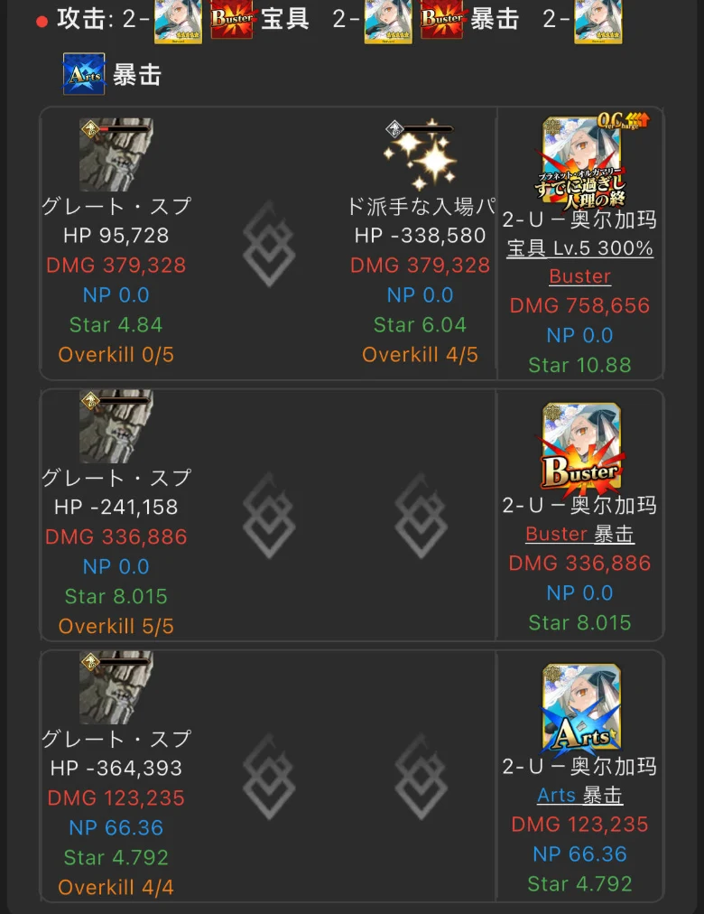

Laplace 战斗记录（完整截图、单栏、显示详情）里的一个回合：每张卡一个格子，敌人栏里有 HP 和红色的 DMG

1. 在 Laplace 的战斗记录里点截图，选「**完整截图**」，用**单栏**、打开「**显示详情**」，保存图片。
2. 在击破概率页的伤害组下面点「**从 Laplace 截图导入**」→「选择截图」，可以一次选好几张。
3. 等识别完，检查每个回合的结果，勾选要导入的回合，点「导入」。

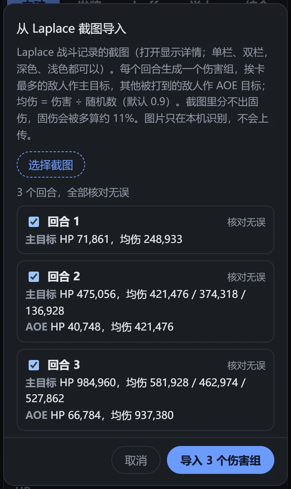

识别结果：每个回合一张卡片，写出主目标、AOE 目标的 HP 和均伤

- **一个回合 = 一个伤害组**，组名是「回合 1」「回合 2」…（选了几张图时前面加「图 2」）。挨卡最多的敌人是主目标，同一回合被打到的其他敌人是 AOE 目标；HP 是这个敌人这回合挨打前的血量（打完后的 HP + 伤害），多血条的敌人也按这样算，自动对上第几条血。
- **均伤 = 截图里的伤害 ÷ 随机数**：Laplace 默认按随机数 0.9 算伤害，所以一般是 ÷ 0.9；改过随机数的卡（伤害后面有「*」，下面写着 RNG）按写出的随机数换算。
- **核对**：同一个敌人后面每张卡的 HP 必须正好减去这张卡的伤害。有数字认错、对不上的回合会标红写出原因，默认不勾选；可以重新截一张更清楚的图，或者导入后自己改。
- **固伤**：截图里分不出固伤，固伤会跟着 ÷ 0.9 被多算约 11%（250 点固伤约多 28）。要精确时，导入后按[基本用法](#kill)里的方法自己改均伤和 HP。
- 图片只在本机识别，不会上传。第一次用要下载约 7 MB 的识别组件，之后断网也能用。

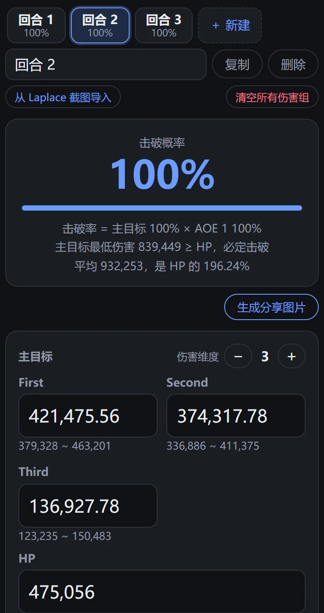

导入后：每个回合一个伤害组，均伤、HP、AOE 目标都填好了

> 目前只支持单栏截图。双栏截图、截图里没有显示详情（看不到每个敌人的 HP、DMG）时读不出来。

## 发牌概率

算发到想要的牌的概率。3 人上场时牌库 15 张，每回合发 5 张，3 个回合发完再洗牌（2 人上场是 10 张、2 个回合）。

### 基本用法：第 1 回合要发到 BB

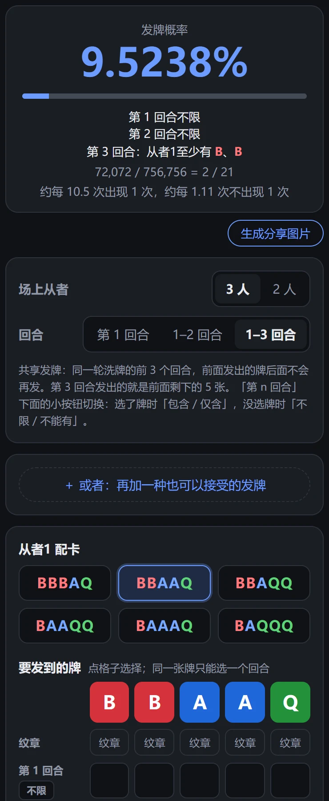

从者1 选配卡 BBAAQ，在「第 1 回合」一行点两张 B

1. **场上从者**选 3 人或 2 人；**回合**先选「第 1 回合」。
2. 在「从者1 配卡」里选这名从者的配卡。
3. 在「第 1 回合」一行点要发到的牌（点一下打勾，再点一下取消）。
4. 最上面是发牌概率，下面是「满足条件的种数 / 全部种数」。

### 包含 / 仅含、不限 / 不能有

「第 n 回合」下面有个小按钮，点它切换这一格的条件：

| 这一格 | 按钮 | 意思 |
| --- | --- | --- |
| 选了牌 | **包含** | 至少发到这些牌，多发也行 |
| 选了牌 | **仅含** | 这名从者发到的牌恰好就是这些，不能多 |
| 没选牌 | **不限** | 这名从者发不发牌都行 |
| 没选牌 | **不能有** | 这名从者一张牌都不能发到 |

### 连续几个回合：1–2 回合、1–3 回合

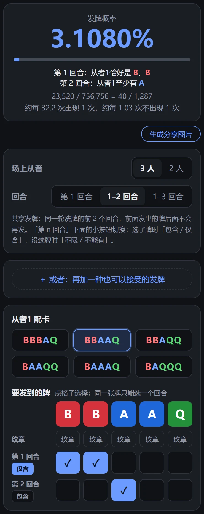

1–2 回合：第 1 回合恰好 BB（仅含），第 2 回合至少一张 A

**回合**选「1–2 回合」或「1–3 回合」时，是**同一轮洗牌**里几个回合一起算：前面发出去的牌后面不会再发，各回合的条件要同时满足。每个回合一行，在对应的行里点牌。同一张牌只能选在一个回合。

### 多名从者、纹章

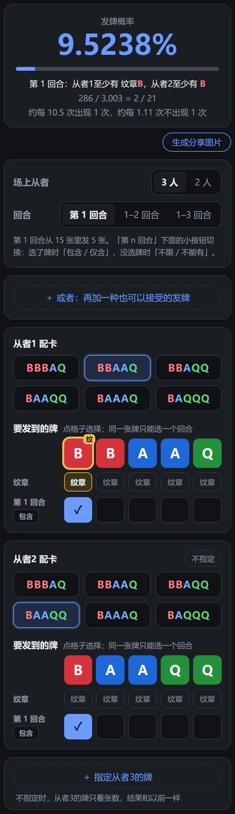

从者1 的第一张 B 开了纹章，从者2 也指定了配卡

- 点「＋ 指定从者2的牌」「＋ 指定从者3的牌」给其他从者选配卡和要发到的牌。不指定时，他们的牌只看张数（结果不受影响）。不同从者的牌互不替代。
- **纹章**：点牌下面的「纹章」，这张牌就只认这一张（例如只有带纹章的那张 B 才行）。同色几张都开纹章时会按 ①②③ 区分。

### 「或者」：几种发牌都能接受

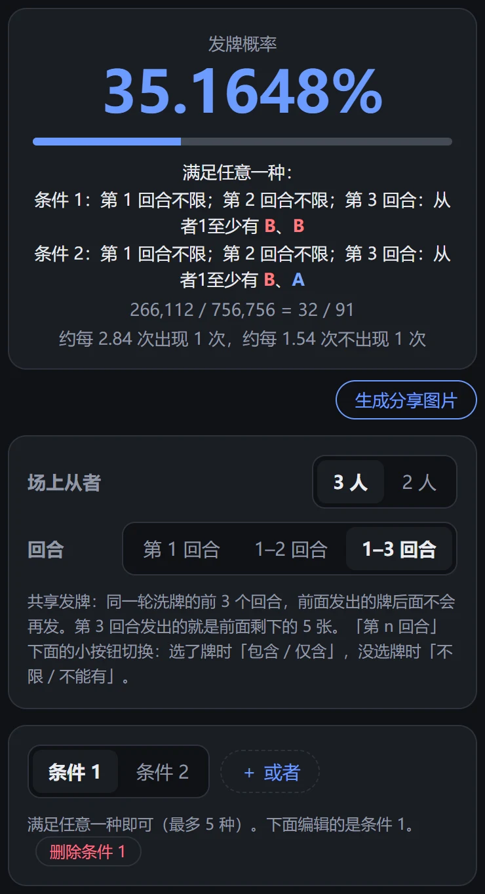

条件 1 要 BB、条件 2 要 BA，满足任意一种即可

BB 能打、BA 也能打时：

1. 先编辑好条件 1。
2. 点「＋ 或者」加条件 2（最多 5 种），点「条件 n」切换正在编辑的条件。
3. 结果是**满足任意一种**的概率。

> 不能把几种条件的概率直接相加：同一手牌可能同时满足好几种，相加会重复计算。这里用容斥原理精确去掉重复的部分。几种牌型的打法、伤害不同时，到[综合页按条件分配](#combo-split)。

### 计算过程

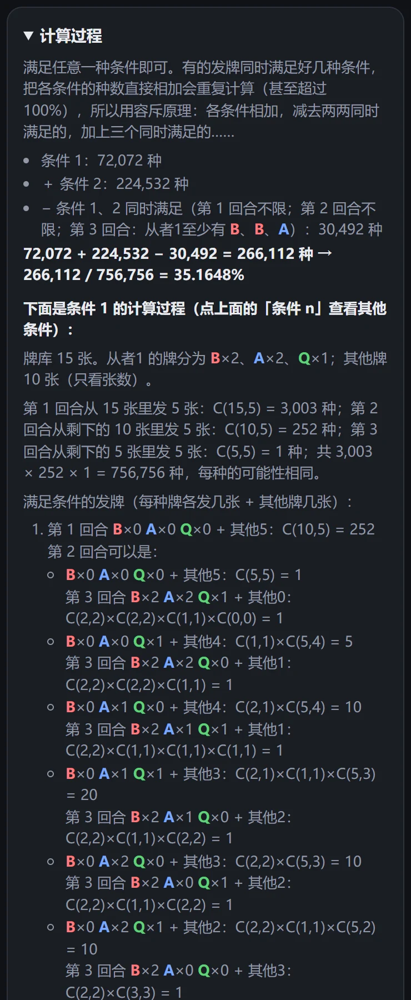

展开「计算过程」，列出每一种满足条件的发牌和组合数

展开页面下方的「计算过程」可以看到每一步：牌库怎么分类、每种满足条件的发牌有几种、怎么相加。想核对结果时很有用。

> 换人、从者退场、洗牌技能会改变牌库，这一页不算。退场后重新洗牌，请在综合页用新的发牌组表示。

## buff 成功率

有些技能不是必中的（魅惑、眩晕、降防……）。一个 buff 组可以放好几个 buff，**全部成功**才算成功。

### 普通 buff

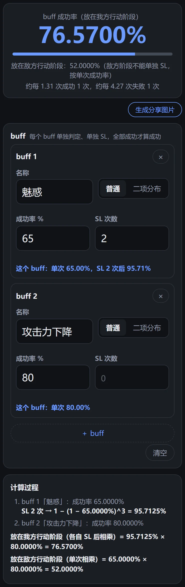

两个 buff：魅惑 65%（SL 2 次）、攻击力下降 80%

1. 名称可以不填（填了在计算过程和综合页里更好认）。
2. **成功率 %** 填这个 buff 的命中率。
3. **SL 次数**：这个 buff 失败时可以重来几次。技能是一个一个放的，一个失败就 SL 重抽它，成功的保留。
4. 「＋ buff」再加一个。最上面是全部成功的概率，每个 buff 下面是它自己的单次和 SL 后的成功率。

### 二项分布 buff：一个技能判定好几次

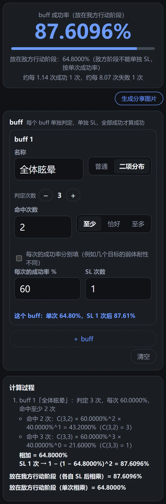

全体眩晕判定 3 次，每次 60%，至少命中 2 个

一个技能同时对好几个目标判定（例如全体眩晕、全体魅惑、凯撒宝具加攻）时，选 **二项分布**：

- **判定次数**：判定几次（几个目标）。
- **命中次数** + 至少 / 恰好 / 至多：命中几次才算成功。
- **每次的成功率**：几个目标的弱体耐性不同时，勾选「每次的成功率分别填」。

> 不要把一个全体技能拆成几个普通 buff：SL 时这几次判定是一起重抽的，拆开算会偏高；「至少 2 个」也没法用普通 buff 表示。

### 两个结果分别用在哪

最上面的大数字是**放在我方行动阶段**的成功率（每个 buff 各自 SL 后相乘）。下面的小字是**放在敌方行动阶段**的成功率：敌方阶段（例如送人前的判定）每条世界线只判定一次、不能单独 SL，所以用单次成功率相乘。在综合页放进哪一行，就用哪个结果。

## 送人概率

敌方行动阶段让敌人把指定的从者打死（送走），这一页算敌方这一回合行动完之后达成要求的概率。

### 基本用法：一个敌人、送走一名从者

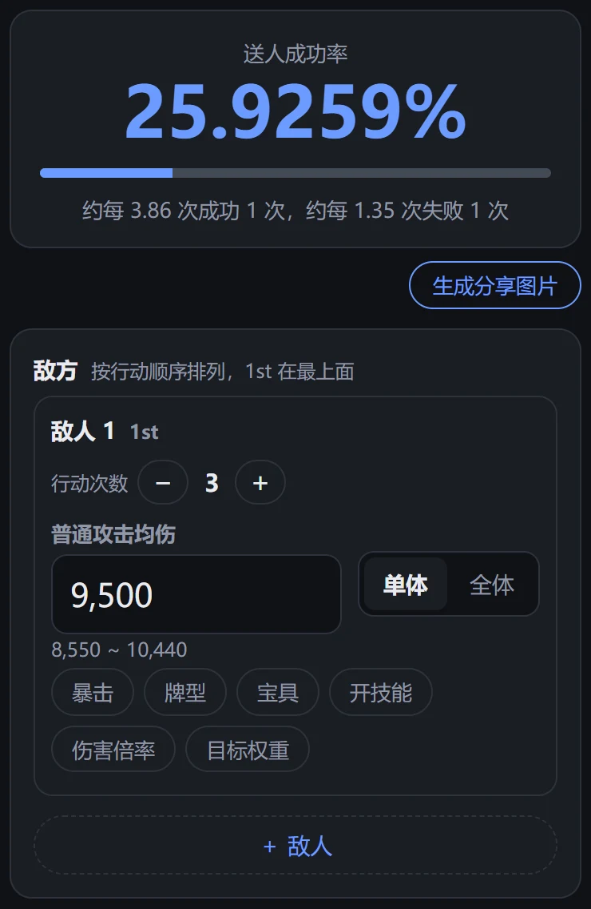

敌人 1 行动 3 次，普通攻击均伤 9,500

**敌方**：

1. **行动次数**：这个敌人这一回合行动几次。
2. **普通攻击均伤**：敌人打你的从者的平均伤害；选 **单体** 或 **全体**。

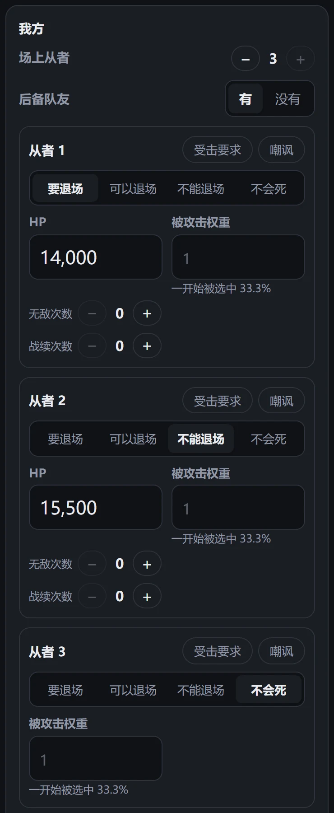

从者1 要退场，从者2 不能退场，从者3 不会死

**我方**：

1. **场上从者**人数；**后备队友**有没有（关系到回合会不会中断）。
2. 每名从者选一个角色：
   - **要退场**：这一回合必须被打死，没死就算失败。
   - **可以退场**：死不死都行。
   - **不能退场**：死了就算失败。
   - **不会死**：不用填 HP（例如满血、不可能被打死的从者）。
3. 填 **HP**（剩余血量）；**被攻击权重**影响敌人选谁打（空着 = 1），下面会显示一开始被选中的概率。

### 敌人的更多设置

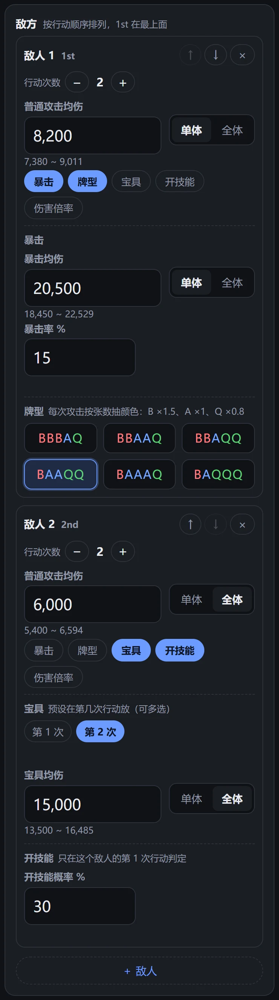

敌人 1 开了暴击和牌型；敌人 2 用全体攻击，第 2 次行动放宝具，第 1 次行动可能开技能

点普通攻击下面的按钮打开对应的设置：

- **暴击**：暴击均伤 + 暴击率。
- **牌型**：敌人的配卡，每次攻击按各颜色张数 ÷ 5 抽颜色（B ×1.5、A ×1、Q ×0.8）。
- **宝具**：选在第几次行动放（可以多选），填宝具均伤；不填 = 无伤害宝具。
- **开技能**：敌人第 1 次行动有一定概率开技能（没有伤害，但算一次行动）。
- **伤害倍率**：再乘一个倍率。

敌人最多 6 个，按 1st、2nd… 的顺序轮流行动，用右上角的 ↑ ↓ 调整顺序，× 删除。

### 我方的更多设置

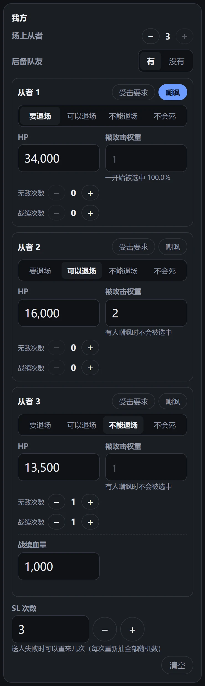

从者1 开嘲讽，从者2 权重 2，从者3 有 1 次无敌、1 次战续

- **嘲讽**：场上有嘲讽的从者时，敌人只打有嘲讽的。
- **无敌次数**：每次挨打伤害为 0，次数 −1。
- **战续次数**：累计伤害达到 HP 时以「战续血量」复活，不算退场。
- 规则细节（战续后的「不合法目标」、回合中断等）见页面底部的「送人规则与使用说明」。

### 看结果：SL 表和详细结果

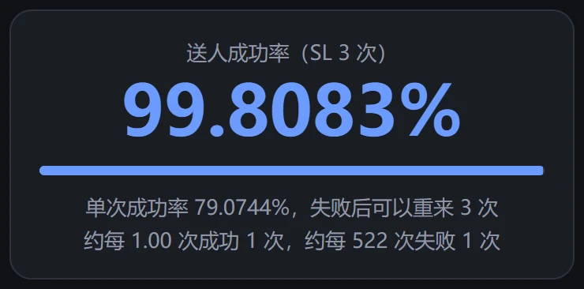

上面是成功率，下面的表列出 SL 次数、每名从者的退场概率

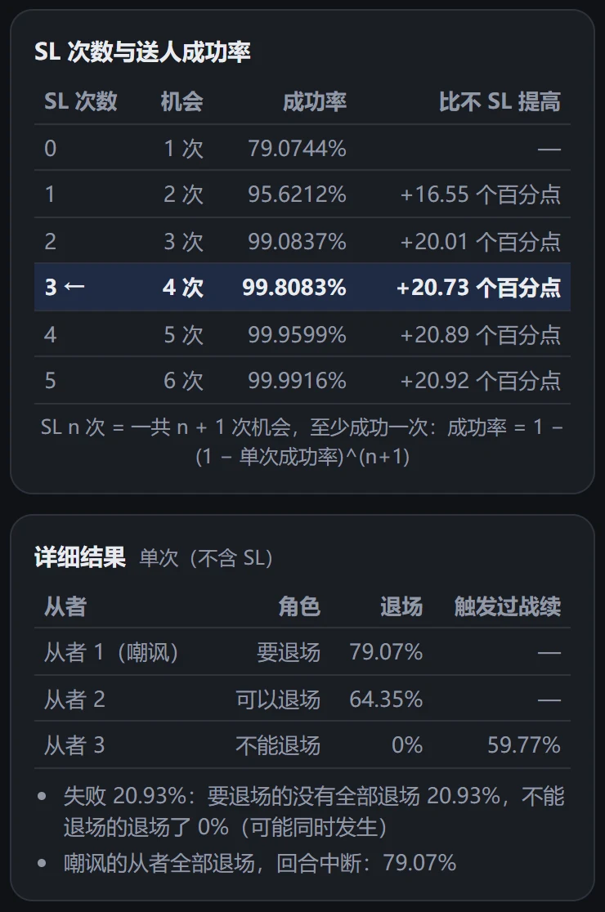

SL 表和详细结果

- **SL 次数**填送人失败时可以重来几次（每次重新抽全部随机数）。
- **详细结果**列出每名从者的退场概率、触发战续的概率，以及失败的原因各占多少，方便看问题出在哪。
- 设置特别复杂时精确计算量太大，会改用模拟，并标明「模拟值」和误差。

### 受击要求：要挨几下（攒 NP、触发被动）

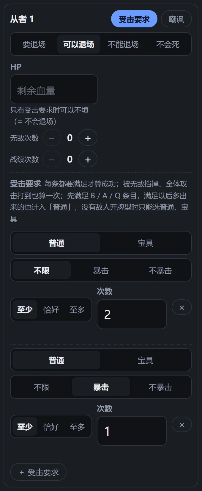

从者1 打开受击要求：至少挨 2 下普通攻击，其中至少 1 下暴击

不需要打死、只需要挨打时（例如靠挨打攒 NP）：

1. 点从者右上角的 **受击要求**。
2. 每一条 = 类型（B / A / Q / 普通 / 宝具）+ 暴击（不限 / 暴击 / 不暴击）+ 至少 / 恰好 / 至多 n 次。
3. 「＋ 受击要求」加更多条，每条都满足才算成功。

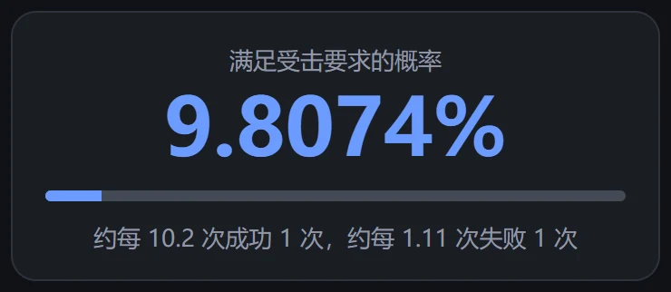

满足受击要求的概率

> 只看受击要求时（没有「要退场」「不能退场」的从者），敌人的均伤、从者的 HP 都可以不填。被无敌挡掉、被全体攻击打到也算挨一下。

## 综合击破概率

把前面四个页面存好的组放进各个回合，算出**整个方案**从头到尾成功的概率（包括发牌、buff、击破、送人每一步，以及 SL 怎么用）。

### 基本用法：把组放进回合

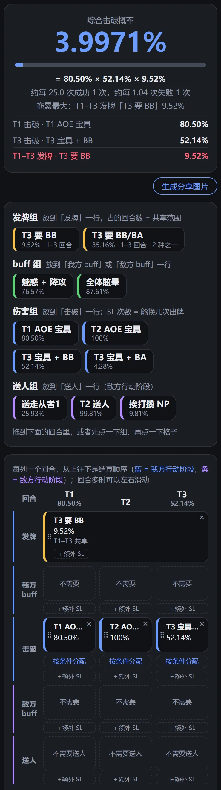

三回合方案：T1–T3 共享一轮发牌，T3 要 BB；每回合一个伤害组

1. 先在前面几页把需要的组建好（例如每回合一个伤害组、一个发牌组）。
2. 在综合页上方找到这些组，**按住拖到下面的格子里**；或者**先点一下组，再点一下格子**。
3. 回合表每一列是一个回合，从上往下是结算顺序：**发牌 → 我方 buff → 击破 → 敌方 buff → 送人**。空着的格子 = 这一步不需要（100%）。
4. 最上面是综合击破概率，下面列出各回合的成功率，并标出「拖累最大」的一步。

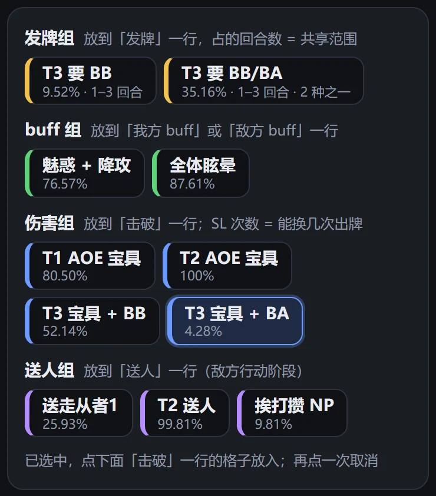

点一下组，它会高亮，再点格子就放进去了

- 放好的组按住左边的 ⠿ 可以拖到别的格子，点 × 移除。
- 底部 − / ＋ 改回合数，「清空方案」清空全部格子。
- 回合多时表格可以左右滑动。

> **发牌组**占几列由它的「回合」设置决定：设成「1–3 回合」的发牌组放在 T1，就覆盖 T1–T3。3 人每 3 回合洗一次牌，有从者退场时下一回合立刻洗牌；发牌组放在不是正常洗牌的回合时会提示「需要前一回合有从者退场」，请自己确认。

### 加上 buff 和送人

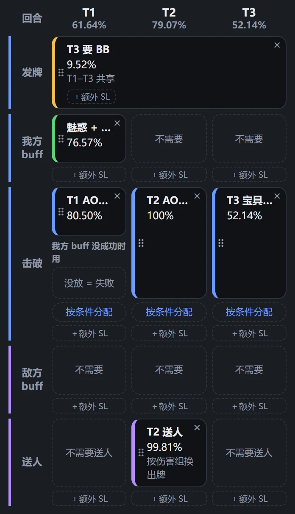

T1 先放魅惑 + 降攻；T2 敌方行动阶段要送人

- **buff 组**可以放进「我方 buff」（我方行动阶段，用 SL 后的成功率）或「敌方 buff」（敌方行动阶段，用单次成功率）。
- 放了我方 buff 后，击破格下面会多出「**我方 buff 没成功时用**」：buff 没挂上时改用哪个伤害组（空着 = 失败）。敌方 buff 和送人也一样。
- **送人组**放进「送人」一行。击破失败时换出牌重来，会连着送人一起重新判定，所以送人格会注明「按伤害组换出牌」。

### 按条件分配：不同的牌用不同的打法

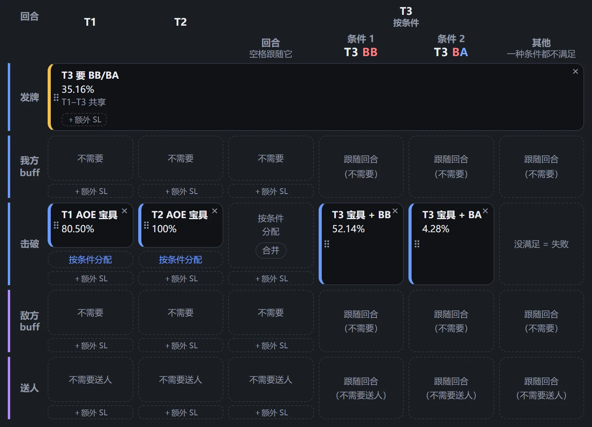

T3 按条件分配：发到 BB 用「T3 宝具 + BB」，发到 BA 用「T3 宝具 + BA」，都没有就失败

发牌组用了「或者」（例如 BB 或 BA 都行），而两种牌的伤害不一样时：

1. 在被这个发牌组覆盖的回合，点击破格下面的「**按条件分配**」。
2. 这一列分成「回合 / 条件 1 / 条件 2 … / 其他」几小列，每小列从上往下就是一种打法。
3. 把每种条件对应的伤害组放进去。条件格空着 = 不需要击破；「其他」（一种条件都不满足）空着 = 失败。
4. 点「合并」变回一列。

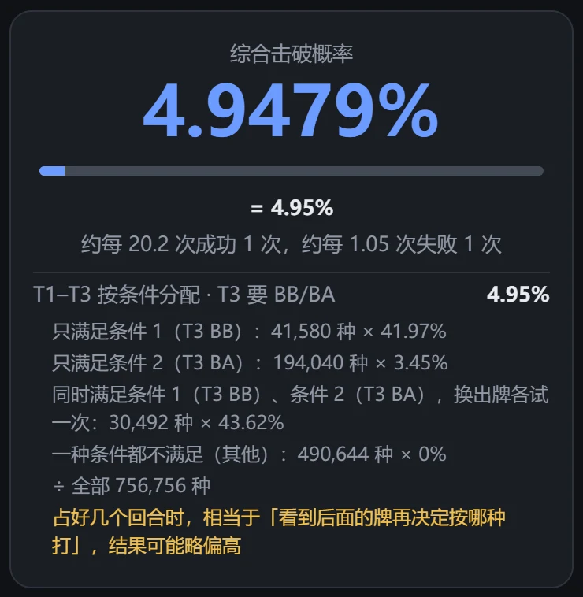

结果里列出只满足条件 1、只满足条件 2、两种都满足各有几种发牌

同时满足好几种条件的手牌，会把不同的打法各试一遍（任意一种成功即可）。

### 额外 SL 和全局额外 SL

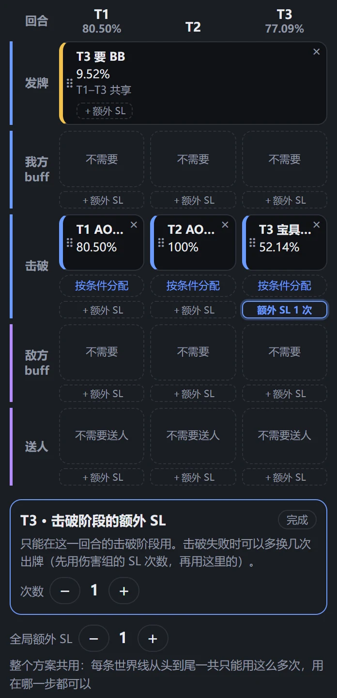

T3 击破阶段加 1 次额外 SL，再加 1 次全局额外 SL

- 每个格子下面的「**＋额外 SL**」：给这一回合的这个阶段多几次 SL，只能用在这里。发牌组下面也有，用来在看到牌之后重新发牌。
- 「**全局额外 SL**」：整个方案共用，每条世界线从头到尾一共只能用这么多次，用在哪一步都可以（程序会选最好的用法）。

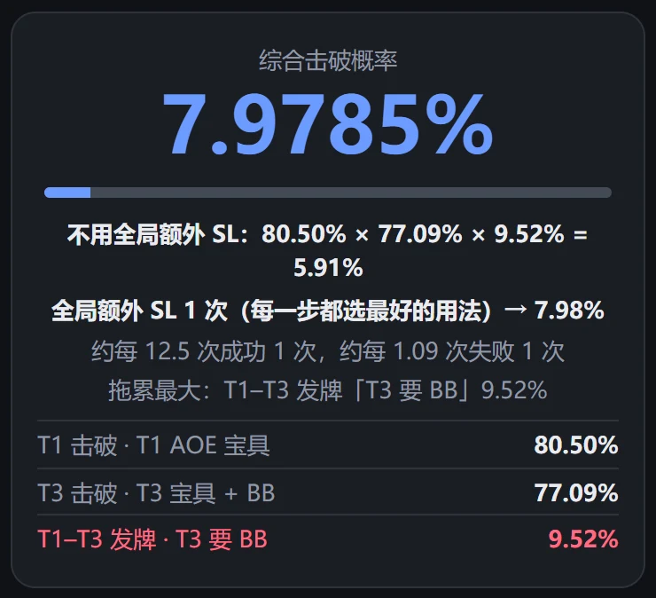

有全局额外 SL 时，结果会分别列出不用和用了的成功率

### 计算过程

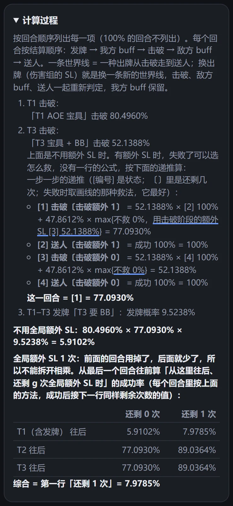

展开「计算过程」查看每一步怎么算

展开「计算过程」可以看到每个回合、每一步的成功率怎么来的。完整规则见 GitHub 上的《世界线规则》。

## 工作目录与分享

### 工作目录：保存整套设置

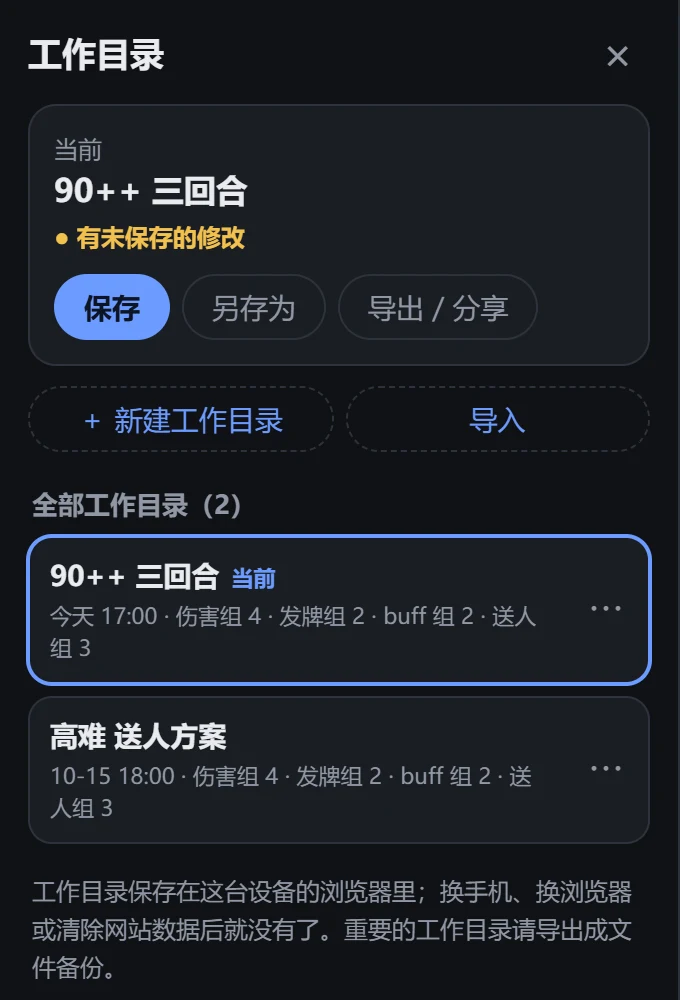

工作目录：保存、另存为、导出，下面是全部工作目录

点左上角的 **工作目录**。一个工作目录 = 全部伤害组、发牌组、buff 组、送人组和综合页的方案。

- **保存**：存进当前工作目录。有没保存的修改时，左上角按钮上会有小圆点。
- **另存为** / **＋ 新建工作目录**：一套方案一个工作目录，随时切换。切换时如果有没保存的修改，会先问你要不要保存。
- 每个工作目录右边的 ⋯：改名、导出、删除。

> 工作目录只保存在这台设备的浏览器里。换手机、换浏览器、清除网站数据后就没有了，重要的请导出成文件备份。

### 导出：发给别人或备份

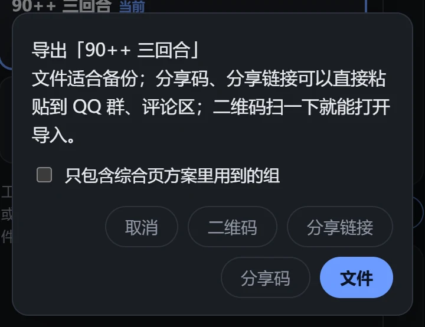

导出可以选文件、分享码、分享链接、二维码

- **文件**：保存成 `.json` 文件，适合备份。
- **分享码** / **分享链接**：一段文字，可以直接贴到 QQ 群、评论区。对方打开链接就会进入导入。
- **二维码**：对方扫一下就能打开导入，也可以保存成图片发出去。
- 勾选「只包含综合页方案里用到的组」可以让分享码更短。

### 导入别人的设置

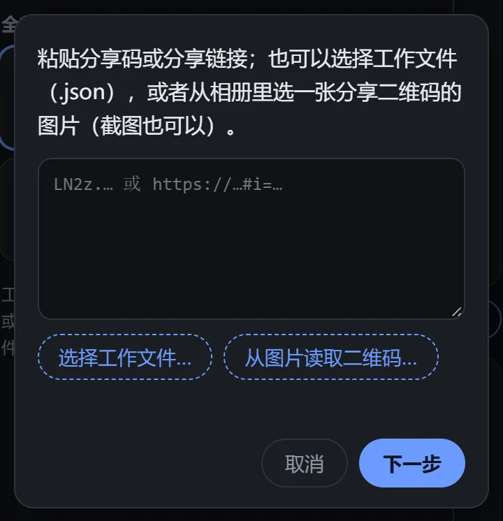

粘贴分享码 / 链接，或者选择文件、从图片读取二维码

点工作目录里的 **导入**：粘贴分享码或链接，或者「选择工作文件…」，或者「从图片读取二维码…」（直接从相册选二维码截图，不需要相册权限）。然后选：

- **作为新的工作目录打开**：不影响你现在的内容。
- **合并到当前**：把对方的组加进你现在的工作目录（你的方案不变）。

### 分享图片：发一张结果截图

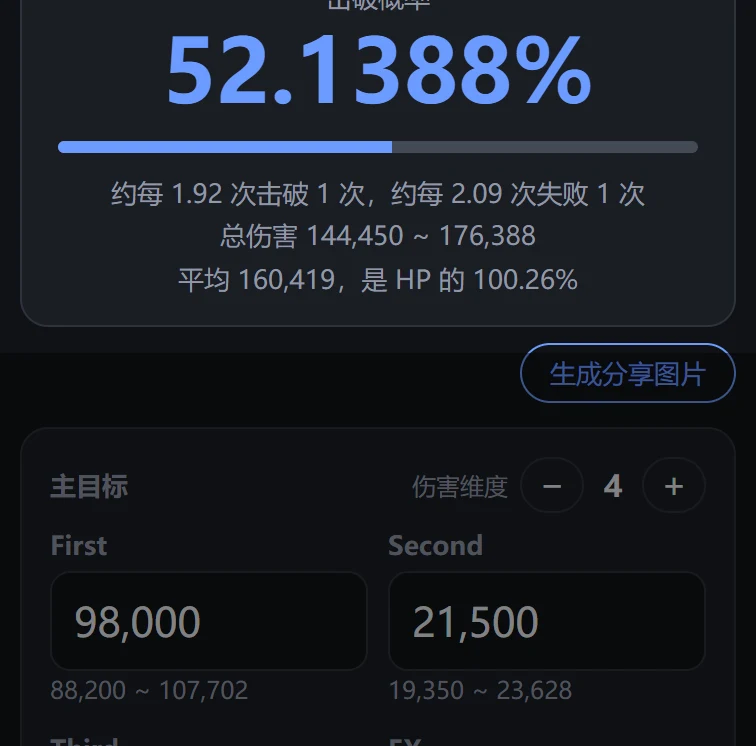

生成分享图片：把这一页的输入和结果排成一张图

每一页结果下面都有「**生成分享图片**」，把这一页的主要输入和结果排成一张整齐的图片，可以保存或复制后发给别人。想让别人导入同样的设置，请用上面的导出。

## 常见问题

**结果和 Excel 计算器对不上？** 本工具每张卡的伤害按「向下取整(均伤 × 随机数)」计算，取整方式和 Excel 计算器相同；请检查均伤是否已经扣掉固伤、HP 是否已经减去固伤之和。

**数据会不会丢？** 输入自动保存在这台设备的浏览器里。清除浏览器数据、在 iPhone 上删掉桌面图标都会清空，请定期在工作目录里导出文件备份。

**断网能用吗？** 能。打开过一次（或添加到主屏幕）之后，断网也能用，计算全部在本机完成。

**还有问题或建议？** 欢迎到 [GitHub 仓库](https://github.com/ada-yl5326/fgo-prob-calc) 或 [作者 B 站主页](https://space.bilibili.com/28108391) 反馈。
